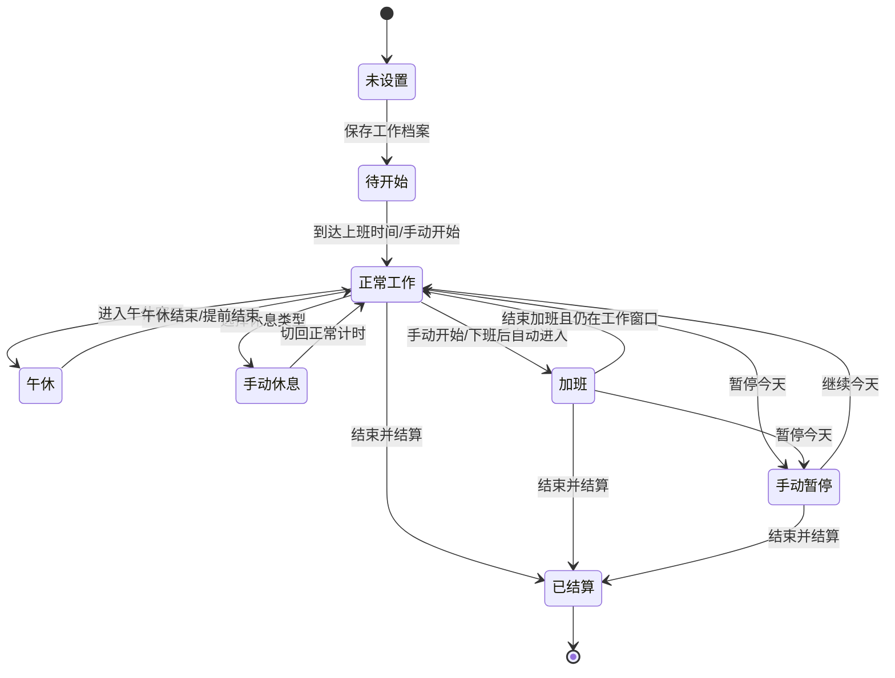

# PAYBEAT V2 · A+B 详细方案

版本：2026-10-23  
状态：第一阶段逻辑和桌宠已落地，页面重排保留到后续迭代  
范围：A「UI 与操作优化」+ B「智能工作模式」

这份方案只定义产品结构和计费规则，不修改当前页面。V2 继续保留现有能力：实时计时、从当天上班时间补算、午休自动跳过、休息冻结后续提速、统一休息选择器、加班、币种、社保/公积金估算、本机隔离和清除本机数据。

## 1. V2 想解决的问题

当前工具的计算逻辑已经完整，但用户第一次打开时还需要理解较多字段；进入工作、休息、加班和临时调整也分散在页面不同位置。V2 把使用过程收敛成两件事：

1. **A：让用户一眼知道现在赚了多少、处于什么状态、下一步该点什么。**
2. **B：让用户先选工作方式，再由系统按当天规则自动判断工作、午休、休息和加班。**

V2 的产品口径是「模式负责安排时间，计时器负责记录事实」。模式只是快捷配置，不会替用户判断是否真的在工作；用户始终可以手动暂停、休息、恢复或结束结算。

## 2. 方案总览

| 模块 | V2 变化 | 保留的当前逻辑 |
| --- | --- | --- |
| 主界面 | 收入、工作状态、当前模式和主操作集中到首屏 | 现有 Editorial 视觉可继续作为基础 |
| 快捷操作 | 休息、正常计时、加班、暂停放入同一操作区 | 休息期间金额冻结 |
| 工作模式 | 用模板快速填写工作日、时间和自动开始规则 | 每个人仍可自定义完整时间 |
| 今日临时调整 | 只修改今天，例如提前上班、延迟下班、今天加班 | 规则修改不会静默重算历史 |
| 状态反馈 | 明确显示「工作中 / 午休 / 休息 / 加班 / 已暂停」 | 实时金额和秒薪继续更新 |
| 数据 | 增加模式和当天快照字段 | 数据仍只保存在当前设备和页面路径 |

## 3. A：UI 与操作优化

### 3.1 首屏信息顺序

首屏从上到下只保留用户最常用的六层信息：

1. **当前工作模式**：例如「标准工作日」「弹性上班」。
2. **今日收入**：金额和货币代码，持续实时更新。
3. **当前状态**：工作中、午休、休息、暂停、加班或已结算。
4. **计时和秒薪**：当前已计费时长、当前每秒收入、今日目标收入。
5. **今日进度**：计划时段、已工作时长、休息时长、加班时长。
6. **主操作**：暂停/继续、开始或结束休息、开始或结束加班、结束并结算。

收入卡不再和设置字段争夺第一视觉位置。社保、公积金和完整规则进入「本月估算」和「计薪设置」，首屏只显示是否启用及一个摘要。

### 3.2 手机端草图（390 × 844）

```text
┌──────────────────────────────┐
│ p/  PAYBEAT          本机保存 │
├──────────────────────────────┤
│ 今日工资                      │
│ 标准工作日        [切换模式⌄] │
│                              │
│        CNY ¥234.00           │
│  今日收入  ·  实时增加中       │
│                              │
│  工作中 · 正常计时             │
│        02:18:36               │
│  每秒 ¥0.0100   今日目标 ¥360 │
│                              │
│  今日计划 10:00—18:00         │
│  ███████████░░░  36%          │
│  已工作 2h18m  休息 0m         │
│                              │
│  [开始休息⌄]   [开始加班]       │
│  [暂停今天]   [结束并结算]       │
├──────────────────────────────┤
│ 今日模式                       │
│ 标准工作日 · 自动开始          │
│ 午休 12:00—13:30 · 不计费      │
│ [今天临时调整]                  │
├──────────────────────────────┤
│ 本月估算  社保/公积金：未启用    │
│ [设置]                         │
└──────────────────────────────┘
```

移动端底部固定操作栏只保留两个高频动作：左侧「休息/正常计时」选择器，右侧根据状态显示「暂停今天」或「继续今天」。加班和结算放在主卡中，避免底部按钮过多。

### 3.3 桌面端草图（1440 × 900）

```text
┌─────────────────────────────────────────────────────────────────────────┐
│ p/ PAYBEAT · Every second counts.                         本机数据       │
├─────────────────────────────────────────────────────────────────────────┤
│ 工资跳动                         [标准工作日⌄] [今天临时调整]             │
│ 今天的收入和工作状态会实时更新                                             │
├───────────────────────────────────────┬─────────────────────────────────┤
│                                       │ 今日模式                         │
│  今日收入                             │ 标准工作日                       │
│  CNY ¥234.00                          │ 周一至周五 · 10:00—18:00         │
│  工作中 · 正常计时                    │ 自动开始 · 午休不计费            │
│                                       │ [切换模式]                       │
│  02:18:36                             ├─────────────────────────────────┤
│  每秒 ¥0.0100  今日目标 ¥360           │ 今日进度                         │
│                                       │ 已工作 2h18m                     │
│  ███████████░░░  36%                   │ 休息 0m · 加班 0m                │
│                                       │ [今天临时调整]                   │
│  [开始休息⌄] [开始加班]               ├─────────────────────────────────┤
│  [暂停今天]   [结束并结算]             │ 最近结算 / 本月估算               │
│                                       │ ...                             │
└───────────────────────────────────────┴─────────────────────────────────┘
```

桌面端保持当前两列结构：左侧承载计时和主操作，右侧承载模式、当天摘要、历史和扣款估算。右侧信息不参与秒级刷新，避免页面频繁跳动。

### 3.4 工作模式选择器草图

```text
┌────────────────────────────────┐
│ 选择今天的工作模式              │
│                                │
│ ● 标准工作日                   │
│   固定上下班，支持自动开始       │
│                                │
│ ○ 弹性上班                     │
│   手动开始，按目标工作时长计费   │
│                                │
│ ○ 远程办公                     │
│   规则不变，默认手动开始         │
│                                │
│ ○ 今天加班                     │
│   在当前模式上增加加班时段       │
│                                │
│ ○ 休息日加班                   │
│   只对今天生效，使用休息日倍率   │
│                                │
│ [使用此模式]  [取消]            │
└────────────────────────────────┘
```

模式选择器只展示用户已经配置过或可快速配置的模式；首次使用仍可进入完整设置，不把复杂字段塞入弹窗首页。

### 3.5 主操作和状态设计

| 当前状态 | 主状态文案 | 首要操作 | 次要操作 |
| --- | --- | --- | --- |
| 未设置 | 等待设置 | 完成计薪设置 | — |
| 已设置待开始 | 准备开始 | 开始今天 | 切换模式 |
| 正常工作 | 工作中 · 正常计时 | 开始休息 | 暂停今天 / 开始加班 |
| 午休 | 午休中 · 金额暂停或带薪 | 提前结束午休 | 暂停今天 |
| 手动休息 | 休息中 · 金额冻结 | 恢复正常计时 | 结束今天 |
| 加班 | 加班中 · 1.5× | 结束加班 | 暂停今天 |
| 手动暂停 | 今日已暂停 | 继续今天 | 结束并结算 |
| 已结算 | 今日已结算 | 查看今日明细 | 修改明天规则 |

按钮文案必须说明动作完成后的结果。比如「开始休息」进入休息，「结束休息」恢复正常计时，避免只显示一个含义不清的“暂停”按钮。

### 3.6 设置页重组

设置分成三层：

- **快速设置**：月薪/收入口径、币种、工作模式、是否自动开始。
- **工作安排**：工作日、上下班、午休、默认休息、每日目标时长、加班规则。
- **高级估算**：社保、公积金、固定金额、基数上下限、雇主成本。

保存按钮显示影响范围：

- 保存工作档案：下一个工作日生效。
- 只改今天：当前日期生成临时快照，结束后自动失效。
- 正在计时：当前已发生金额保留，页面显示新规则的生效日期。

### 3.7 文案和可访问性

- 所有金额同时显示币种代码和符号，例如 `USD $12.34`、`JPY ¥1200`。
- 状态使用文字和颜色双重表达，不能只靠颜色区分。
- 每秒更新的金额区域使用 `aria-live="polite"`，计时数字不逐字播报。
- 休息和加班按钮提供键盘焦点样式，触控目标至少 `44 × 44 px`。
- 任何自动开始、自动进入加班的开关都在开关旁写清楚触发条件。

## 4. B：智能工作模式

### 4.1 模式定义

模式是「工作档案 + 当天规则」的组合，不创建账号，也不改变本机隔离方式。

| 模式 | 默认行为 | 适合场景 | 计费口径 |
| --- | --- | --- | --- |
| 标准工作日 | 到上班时间自动开始，午休按设置处理 | 固定上下班 | 正常时段使用正常秒薪 |
| 弹性上班 | 手动点击开始，按目标工作时长计算 | 弹性工时、错峰上班 | 只在实际工作段计费 |
| 远程办公 | 默认手动开始，可保留固定工作窗口 | 居家办公、地点变化 | 与正常模式相同，不读取定位 |
| 今天加班 | 在当前模式上增加延时或手动加班 | 下班后继续工作 | 追加加班倍率 |
| 休息日加班 | 今天临时变为加班日 | 周末或未选工作日 | 使用休息日倍率 |

「远程办公」是工作安排标签，不代表系统会定位、读取摄像头或判断用户是否在工位。它与标准模式的区别只体现在默认开始方式和当天提示。

### 4.2 模式字段

```ts
WorkMode {
  id: 'standard' | 'flexible' | 'remote' | 'overtime' | 'rest_day_overtime'
  label: string
  autoStart: boolean
  workdays: number[]
  workWindows: TimeWindow[]
  lunchWindow?: TimeWindow
  targetWorkMinutes?: number
  overtime: OvertimeRule
}

DayOverride {
  date: 'YYYY-MM-DD'
  modeId?: WorkMode['id']
  startAt?: 'HH:mm'
  endAt?: 'HH:mm'
  targetWorkMinutes?: number
  overtimeEnabled?: boolean
  note?: string
}
```

当前版本的 `monthlySalary`、币种、社保公积金和历史字段继续兼容；V2 只增加 `modeId`、`dayOverride` 和每日事件快照。

### 4.3 标准工作日

默认使用当前已验证规则：

- 到达工作日的上班时间后自动开始；用户当天更晚打开时，从上班时间补算至当前时刻。
- 午休按「不计费」或「带薪」设置处理。
- 手动休息、带薪摸鱼、离岗和拉屎共用统一休息操作。
- 休息期间金额冻结；恢复后以当天目标收入扣除已获得金额，再按剩余可计费时段计算后续秒薪。
- 下班前达到当天目标后停止增加；开启自动加班时才进入加班状态。

### 4.4 弹性上班

弹性模式不根据固定上班时间自动补算，用户点击「开始今天」才建立计费起点。

建议提供两个字段：

- 每日目标工作时长，例如 `8 小时`。
- 可选的工作时间范围，例如 `08:00—22:00`，用于限制自动计算范围。

用户中途休息时，休息时长不计入目标工作时长；恢复后继续累计。当天结束时，如果目标时长未完成，页面显示「未完成目标」，不自动补计虚拟收入。

### 4.5 远程办公

远程模式不接入定位，也不上传任何办公信息。它只提供三个 UI 变化：

- 默认采用手动开始，防止用户在未准备好时自动计时。
- 顶部状态显示「远程办公」，让用户知道今天使用的规则。
- 支持添加当天备注，例如「家中」「咖啡店」，备注只存本机，不写入公开链接。

计算方式与标准工作日相同，用户仍可启用自动开始。

### 4.6 今天加班

加班分成三种入口：

1. **下班后自动进入**：在设置中明确开启；工作日超过计划结束时间时进入加班。
2. **手动开始加班**：用户点击后立即建立加班段，适用于提前加班或不规则加班。
3. **休息日加班**：在今天临时调整中选择，使用休息日倍率。

默认倍率建议保持：工作日延时 `1.5×`、休息日 `2.0×`、特殊日期 `3.0×`。这些是用户可编辑的产品预设，不代表法律结论。

每个加班段保存开始时间、结束时间、倍率和倍率来源。以后修改倍率不会重算已经结算的历史。

### 4.7 今天临时调整

「今天临时调整」是 V2 的核心入口，不改变长期工作档案。建议提供：

- 今天提前上班。
- 今天延迟下班。
- 今天改为远程办公。
- 今天标记为休息日加班。
- 今天关闭自动开始。
- 今天使用不同的午休时间。

调整保存后在主卡显示明显提示：`今天使用临时规则 · 明天恢复标准工作日`。临时规则写入当天快照，次日自动失效。

## 5. 自动状态和计费优先级

### 5.1 状态图草图



### 5.2 同时命中多个规则时的优先级

同一秒只能命中一个状态，优先级固定为：

1. 用户主动结束或手动暂停。
2. 用户主动选择的不计费休息。
3. 午休窗口。
4. 加班窗口。
5. 正常工作窗口。
6. 非工作时间空闲。

如果时间段重叠，保存时指出具体冲突，不自动猜测。例如「午休 12:00—13:30」和「个人休息 13:00—14:00」不能静默覆盖。

### 5.3 秒薪和目标收入

- 正常模式：沿用当前日目标收入和剩余时段提速规则。
- 带薪休息：金额保持增加，但不减少当天目标收入；恢复后按剩余正常时段重新分配。
- 不计费休息：金额冻结，恢复后按照当前规则继续。
- 加班：正常收入和加班收入分开记录，不能把加班倍率混入正常秒薪。
- 弹性模式：按实际计费分钟和配置的正常单价计算，不为了达成目标时长自动补钱。

## 6. 模式切换流程

```text
打开页面
  ↓
读取当前页面路径下的本机档案
  ↓
显示当前模式和今天状态
  ├─ 没有档案 → 选择模式 + 完成计薪设置
  ├─ 有档案且未开始 → 开始今天 / 切换模式
  └─ 正在计时 → 休息、暂停、加班或今天临时调整
                         ↓
                 保存当天事件快照
                         ↓
                 继续实时计时并更新收入
```

模式切换分两种：

- **未开始前切换**：直接切换，不产生事件。
- **已经开始后切换**：提示「今天已有计时，是否只对今天使用临时规则？」；确认后保存当天快照，不修改已经发生的金额。

## 7. 数据和迁移建议

### 7.1 新增数据

```ts
PayBeatV2State {
  schemaVersion: 9
  activeModeId: string
  savedModes: WorkMode[]
  dayOverrides: Record<string, DayOverride>
  today: {
    date: string
    modeSnapshot: WorkMode
    overrideSnapshot?: DayOverride
    activeSegment: 'work' | 'lunch' | 'break' | 'overtime' | 'paused' | null
    events: TimerEvent[]
    normalBillableMs: number
    overtimeBillableMs: number
    unpaidBreakMs: number
    grossAmount: number
  }
}
```

### 7.2 迁移规则

- 旧版 `schemaVersion: 8` 自动映射为「标准工作日」。
- 原有工作日、上下班、午休、币种、社保公积金和加班字段原样保留。
- 旧版统一休息状态迁移为当天事件，不重新计算已经获得的金额。
- 旧版历史记录写入 `modeSnapshot: 'standard'`，旧数据不补写不存在的模式信息。
- 页面路径隔离键继续保留，V2 不把任何数据上传到服务器。

## 8. 验收标准

### A：界面和操作

- 用户打开页面后，3 秒内能找到今日收入、工作状态和当前模式。
- 手机首屏无需进入设置即可完成「开始休息」「恢复正常计时」「暂停今天」三项操作。
- 模式、休息和加班的按钮状态在工作中、午休、暂停和已结算时均有明确文案。
- 桌面端保留两列布局，右侧摘要不会因秒级刷新抖动。
- 货币代码、金额、状态和按钮在 390px 宽度下不发生横向溢出。

### B：智能模式

- 标准工作日继续支持从上班时间补算到首次打开时刻。
- 弹性上班不会在用户未点击开始前自动产生收入。
- 远程办公不读取定位、不上传备注，且可手动开始。
- 工作日加班、休息日加班和手动加班分别使用正确倍率。
- 今天临时调整只影响当天，次日恢复长期模式。
- 修改长期规则不会重算已发生或已结算金额。
- 模式、事件、倍率和币种快照可在本机刷新后恢复。

### 隐私

- 不新增账号、云同步、定位、摄像头、麦克风或后台隐形计时。
- 清除本机数据后，当前页面的模式、设置、当天计时和历史全部清空。
- 不同页面路径、不同浏览器和不同设备之间不共享计时痕迹。

## 9. 建议的实现顺序

### 第 0 步：确认产品口径

确认模式名称、弹性模式的目标时长、远程模式是否需要备注，以及加班自动开始是否默认关闭。

### 第 1 步：先做状态和数据层

新增模式、当天临时规则和事件快照；先用现有 UI 验证状态流转，避免同时改计算和视觉。

### 第 2 步：实现 A 的主界面

重排首屏信息、模式选择器、主操作区、当天进度和设置分层；手机端先完成，再适配桌面端。

### 第 3 步：实现 B 的模式入口

加入标准、弹性、远程、今天加班、休息日加班及临时调整；完成自动状态机和倍率快照。

### 第 4 步：验证和 Figma 交接

补充模式切换、跨午休、跨下班、刷新恢复、移动端溢出和本机清除数据测试，再根据最终页面生成 V2 Figma 交接数据。

## 10. V2 暂不包含

- 不接入定位、考勤、摄像头或企业系统。
- 不自动读取当地节假日和社保政策。
- 不做实时汇率和货币换算。
- 不创建账号、不做云同步、不跨设备合并历史。
- 不把 PayBeat 变成工资单、个税申报或法律考勤工具。

## 11. 需要你确认的四个选项

1. 弹性上班是否使用「每日目标工作时长」作为主要规则？建议：使用，默认 8 小时。
2. 远程办公是否只作为模式标签，不改变计费公式？建议：是。
3. 下班后自动进入加班是否默认关闭？建议：关闭，避免用户忘记停止导致多算。
4. V2 是否先做手机端，再做桌面端？建议：是，先完成 390px 主流程，再扩展 1440px。

确认后，下一步可以先输出 V2 的页面状态清单和 Figma 画板清单，再开始修改主工具界面和计算逻辑。
## 12. 本次方案修订：隐私显示 + 每秒收入喜悦

根据新的目标，V2 不把“清楚显示工资数字”作为唯一反馈。主目标调整为：

> 用户可以保护自己的具体薪资，同时仍然能感受到每一秒都在产生收入。

因此，V2 的反馈拆成两层：

- **真实金额层**：默认隐藏，只有用户主动按下时显示。
- **情绪反馈层**：通过状态、进度、金币、像素人物动作和轻量动画，让用户持续感知“这一秒有收入增加”。

金额计算、历史记录和金币表现彼此独立，动画不改变账本。金币按真实收入门槛触发：每 0.5 个币种单位是小金币，每 20 个单位是大金币，每 100 个单位是旗子。桌宠不显示工资数字，但门槛反馈会反映收入增量；安静模式可关闭这类反馈。

### 12.1 金额默认遮挡

桌面端和手机端都默认使用遮挡显示：

```text
今日收入       CNY  ••••••
每秒增加       CNY  ••••
今日目标       CNY  ••••••
```

建议保留币种代码，不直接显示金额。用户仍能知道当前使用的是 `CNY`、`USD` 或其他币种，但旁人无法通过页面直接看到具体数值。

遮挡状态旁显示一个小锁图标和提示：`按下查看`。首次使用时只提示一次，之后不重复打扰。

### 12.2 按下显示规则

金额显示采用“按下查看，松手恢复”的交互：

1. 用户按下金额卡、锁图标或“按下查看”区域。
2. 按下后立即解除遮挡，并显示真实金额。
3. 用户持续按住时保持显示。
4. 用户松手、手指移出、鼠标抬起、键盘松开、页面失去焦点或切换标签页时，立即重新遮挡。
5. 短按只在按下期间显示金额，也不触发链接、按钮或复制。
6. 不把金额写入 URL、页面标题、浏览器通知或可见的无障碍朗读文本。

手机端需要处理 `pointerdown / pointerup / pointercancel / touchend`；桌面端支持鼠标按下和键盘按下 `Space` / `Enter`。浏览器上下文菜单和文字选择不能在金额区域弹出。

### 12.3 按下状态草图

```text
默认状态                         按下即显示                    松手
┌────────────────┐              ┌────────────────┐                ┌────────────────┐
│ 今日收入       │              │ 今日收入       │                │ 今日收入       │
│ CNY  ••••••  ◉ │  ──按下──→   │ CNY  ¥234.00 ◉ │  ──松手──→      │ CNY  ••••••  ◉ │
│ 按下查看       │              │ 正在查看       │                │ 按下查看       │
└────────────────┘              └────────────────┘                └────────────────┘
```

“按下查看”只应该作用于金额区域，状态、计时、工作模式和进度始终可以正常看到。这样用户既能确认自己当前赚了多少，又不会在共享办公环境中持续暴露工资。

### 12.4 不同状态下的反馈

| 状态 | 金额显示 | 情绪反馈 | 桌宠行为 |
| --- | --- | --- | --- |
| 正常工作且收入增长 | 遮挡 | 每秒轻微闪光，按节奏增加金币能量 | 前进、收集金币 |
| 午休或不计费休息 | 遮挡 | 闪光和金币停止，显示“休息中” | 坐下或进入待机 |
| 带薪摸鱼 / 离岗 / 拉屎 | 遮挡 | 当前薪资和反馈冻结，返回后提高剩余时间秒薪 | 停止前进和奖励，返回后继续 |
| 手动暂停 | 遮挡 | 反馈停止，显示暂停图标 | 停在原地 |
| 加班 | 遮挡 | 金币颜色或光效变化，显示倍率标签 | 进入更高难度关卡 |
| 已结算 | 遮挡 | 完成音效/动画可选，停止实时反馈 | 到达终点并保存金币箱 |

所有动画都以“实际收入是否增加”为准，不以页面刷新次数为准。收入冻结时不能继续生成金币。

## 13. 桌面端像素桌宠

### 13.1 产品定位

桌宠是桌面端的可选陪伴层，负责把“每秒收入增长”转换成一个轻量的像素闯关反馈。它不是独立计时器，也不改变工资计算；关闭桌宠、刷新页面或切换浏览器都不会影响收入。

网页端保留右栏预览；Windows 本地版使用独立透明置顶浮窗，支持桌面拖动、托盘召回和关闭工资工具后继续运行。

### 13.2 桌宠组成

```text
┌──────────────────────────────────────────────┐
│ PAYBEAT 桌面端                                │
│                                              │
│  今日收入  ••••••       工作中 · 正常计时      │
│                                              │
│                              ┌─────────────┐ │
│  今日进度 ███████░░           │   🟨  x 12  │ │
│                              │  o          │ │
│                              │ /|\  →      │ │
│                              │ / \     🪙  │ │
│                              └─────────────┘ │
│  [休息] [加班] [暂停]        [隐藏桌宠]       │
└──────────────────────────────────────────────┘
```

桌宠区域包含：

- 像素人物：站立、行走、休息、暂停、庆祝、结算六组动作。
- 关卡背景：工作日进度、午休休息点、加班夜路等轻量场景。
- 金币反馈：按真实收入门槛收集小金币、大金币和旗子，不显示累计工资数字。
- 状态提示：`工作中`、`休息中`、`加班中`、`已暂停`。
- 隐藏按钮：一键关闭动画，保留普通计时和金额遮挡。

### 13.3 每秒收入到桌宠反馈的映射

真实计费引擎每次产生收入增量时发出一个内部事件：

```ts
IncomeTick {
  occurredAt: number
  delta: number
  currencyCode: string
  rateType: 'normal' | 'overtime'
  isBillable: boolean
}
```

以上为事件概念草图。当前实现由工资工具向本机主进程发送整数收入、日期、币种和计费状态；主进程判断门槛后，仅向桌宠绘制窗口发送奖励种类和前进距离：

- 每个有效收入 tick：人物、金币或背景出现一次极轻微反馈。
- 连续收入 tick：累计为“能量条”，每秒反馈但控制动画数量。
- 人物持续向前，路面向后滚动，不按固定周期回到起点。今日收入每跨过 0.5 个币种单位收小金币；20 的倍数升级为大金币；100 的倍数升级为旗子。同一更新只展示最高级别，不堆积奖励。
- 加班 tick：金币颜色、背景或人物动作变化，但不直接显示倍率金额。
- 休息、暂停或非计费窗口：不生成金币，人物进入对应待机动作。
- 恢复计费：从下一个真实收入 tick 继续，不补发暂停期间的金币。

这样人物每秒都在前进，金币则对应真实收入的整数门槛。首次打开、刷新、睡眠恢复会接上当前进度，不补播历史奖励。切换币种后重建基准，门槛使用所选币种单位。

### 13.4 桌宠关卡设计

建议先做四个简单关卡：

| 关卡 | 触发条件 | 视觉反馈 |
| --- | --- | --- |
| 出发 | 当天开始计时 | 人物从起点出发 |
| 工作路段 | 正常收入增长 | 持续向前，每 0.5 / 20 / 100 个币种单位触发小金币 / 大金币 / 旗子 |
| 休息站 | 午休或手动休息 | 人物坐下，背景保持安静 |
| 加班路段 | 开始加班 | 夜色/新地图/不同金币样式 |
| 终点 | 结束并结算 | 人物到达终点，金币箱合上 |

关卡不设置失败、不扣钱、不影响工作状态，也不要求用户完成任务才能获得收入。它只是把真实发生的收入增长转成视觉陪伴。

### 13.5 桌宠与金额隐私

- 桌宠不显示今日累计金额、月薪或秒薪数字；奖励对应整数收入门槛，不进行货币兑换。
- 金币数量建议使用短周期能量袋、进度段或模糊数量，而不是永久累计的精确计数。
- 收入遮挡和桌宠隐藏是两个独立开关：用户可以看桌宠但隐藏金额，也可以显示金额但关闭桌宠。
- 屏幕共享、投屏或录屏时，桌宠提供“一键安静模式”：隐藏金币变化，只保留人物待机和状态文字。
- 浏览器通知默认关闭，避免工资金额出现在系统通知栏。

### 13.6 手机端处理

手机端默认不显示桌宠，避免占用主卡空间和电量。可在“体验设置”中开启一个轻量版：

- 只显示收入增加时的微型金币闪光。
- 不显示完整地图和人物移动。
- 页面切到后台时停止动画，但计时继续按现有规则运行。
- 回到页面时根据真实状态恢复，不补播后台期间动画。

## 14. 修订后的首屏草图

### 手机端

```text
┌──────────────────────────────┐
│ p/ PAYBEAT          🔒 本机保存│
├──────────────────────────────┤
│ 今日工资        标准工作日⌄   │
│                              │
│        CNY  ••••••  ◉         │
│        按下查看               │
│  工作中 · 正常计时  ✦ +1      │
│        02:18:36               │
│  每秒  ••••   今日目标  ••••   │
│                              │
│  今日进度  ███████░░  36%      │
│  已工作 2h18m · 休息 0m        │
│                              │
│  [开始休息⌄]   [开始加班]       │
│  [暂停今天]   [结束并结算]       │
├──────────────────────────────┤
│ 标准工作日 · 自动开始          │
│ 午休 12:00—13:30 · 不计费      │
│ [今天临时调整]                  │
└──────────────────────────────┘
```

`✦ +1` 是一秒收入反馈，不代表一元或一美元。若当前收入冻结，改为 `休息中 · 等待继续`，不再出现 `+1`。

### 桌面端

```text
┌─────────────────────────────────────────────────────────────┐
│ PAYBEAT                                  🔒 金额已遮挡        │
├───────────────────────────────────────┬─────────────────────┤
│ 今日收入                              │ 今日模式            │
│ CNY  ••••••  ◉                        │ 标准工作日          │
│ 工作中 · 正常计时       ✦ +1          │ 周一至周五           │
│ 02:18:36                              │ 10:00—18:00         │
│                                       ├─────────────────────┤
│ 进度 ███████░░ 36%                    │ 今日进度            │
│ 已工作 2h18m · 休息 0m                │ 已工作 2h18m         │
│                                       │ 休息 0m · 加班 0m    │
│ [开始休息⌄] [开始加班]                ├─────────────────────┤
│ [暂停今天] [结束并结算]               │ [隐藏桌宠]           │
│                                       │                     │
│                                       │  o                  │
│                                       │ /|\  →  🪙           │
│                                       │ / \                │
└───────────────────────────────────────┴─────────────────────┘
```

桌面端的桌宠放在右栏下半区，不覆盖主计时卡、不遮挡按钮、不参与金额遮挡区域。窗口较窄时自动收起为一个人物图标，点击后展开。

## 15. 产品取舍和收敛策略

这次增加桌宠后，V2 仍然只保留一个核心循环：

```text
真实收入每秒增长
      ↓
金额默认保护隐私
      ↓
状态和金币给出即时反馈
      ↓
人物前进，用户感到“我又赚到了一秒”
      ↓
休息/暂停时反馈停止，恢复后从真实 tick 继续
```

明确不做以下扩张：

- 不做复杂 RPG、战斗、装备、排行榜或社交系统。
- 不把金币兑换成真实金额，不设置充值、消费或抽奖。
- 不让桌宠自动开始或停止计时，不让游戏状态覆盖工作状态。
- 不让金币动画代替“按下查看”金额交互。
- 不在手机端强行加入完整桌宠。

V2 的情绪目标不是让用户沉迷游戏，而是让每一秒真实的收入增长拥有一个轻量、可感知、可暂停的视觉回声。

## 16. 新增验收标准

### 隐私显示

- 手机和电脑首次打开时，今日收入、每秒增加和今日目标默认全部遮挡。
- 按下立即显示真实金额，松手、移出、切屏或失焦后立即恢复遮挡。
- 按下显示，松手恢复遮挡，不会复制金额。
- 键盘按下 `Space` / `Enter` 可完成同样操作，松开即遮挡。
- 桌面录屏和页面标题不包含真实金额。

### 桌宠反馈

- 每 0.5 个币种单位收小金币，20 的倍数收大金币，100 的倍数出现旗子；非计费或暂停期间不产生新奖励。
- 按下即显示、松手即遮挡；桌宠无工资数字，安静模式隐藏收入门槛反馈。
- 桌宠隐藏后，收入计算、状态切换和历史结算不受影响。
- 页面刷新后，当前工作状态和真实金额照常恢复；动画从当前状态重新开始，不补播历史动画。
- 在 390px 手机页面中，桌宠默认不出现且不造成横向滚动。
- 在桌面端窄窗口中，桌宠可自动折叠，不遮挡金额、状态和主操作。
- 减少动画设置开启后，桌宠改为静态人物或极轻量闪光。

## 17. 更新后的实施顺序

1. **先实现金额遮挡交互**：桌面和手机共用按下/松手状态，补充失焦、切页、键盘和触控测试。
2. **再实现收入 tick 事件**：让真实计费层输出统一事件，桌宠和手机微反馈只消费事件，不参与计费。
3. **桌面端先做静态像素人物**：先完成站立、工作、休息、暂停四种状态。
4. **加入金币反馈**：验证持续前进、0.5 / 20 / 100 收入门槛、休息停止、恢复继续和禁止补播。
5. **补充桌面窄窗口和手机降级**：桌面折叠为图标，手机只保留微型闪光。
6. **最后统一 A+B 页面布局**：把隐私金额卡、模式选择、今日进度和桌宠放入最终 UI。

本轮已经确认的产品选项：

1. 默认完全遮挡 `••••••`；按下立即显示，松手恢复。
2. Windows 使用可拖动的独立透明置顶窗口，双击应用打开；网页保留预览。
3. 人物持续向前走；小金币 / 大金币 / 旗子对应 0.5 / 20 / 100 个真实币种单位。
## 18. 第一阶段实现状态（2026-10-26）

已在经典主工具 `index.html` 与 `pay-by-second.html` 落地以下 V2 第一阶段能力：

- 今日收入、每秒单价、每秒增加、月薪摘要、扣款估算和历史金额默认使用币种代码加遮挡符显示。
- 按下今日收入立即显示真实金额；松手、移出金额区域、取消触控、键盘松开、页面失焦或切换标签页后立即重新遮挡。
- 短按只在按下期间显示金额，不会复制金额；桌面端支持鼠标按下和 `Space` / `Enter` 按下查看。
- 网页预览和 Windows 独立桌宠均跟随真实收入；小人持续向前，按 0.5 / 20 / 100 个币种单位触发小金币 / 大金币 / 旗子。午休、休息和暂停时停止，加班时继续。
- 桌宠根据计费状态、时长及整数收入门槛驱动反馈，不显示工资数字；隐藏桌宠不影响计时、结算和历史记录。
- 手机端默认隐藏完整桌宠，不占用首屏空间，也不产生横向滚动；电脑窄窗口和弹窗模式自动隐藏桌宠。
- `prefers-reduced-motion` 开启时，桌宠停止行走和金币动画，保留静态状态。

验证结果（2026-10-26）：基础回归 7 组、边界回归 16 组、V2 交互验证 8 组全部通过，没有浏览器脚本错误；主工具四个 HTML 入口内容一致，内嵌脚本均通过 Node.js 语法检查。

本轮修复了长金额换行引起按钮位移、误中断按下查看的问题。鼠标、键盘 Space / Enter、手机触控都已覆盖；按下、移开、松手、触控取消、失焦、滚动和重新打开都会保持或恢复遮挡。桌宠隐藏、休息、午休、加班、后台恢复与减少动画均已验证。390px 手机和 1440px 电脑预览见 `预览图/V2/`；320px 至 780px 窄窗口无横向溢出。

交付范围为第一阶段主工具和 Windows 独立桌宠；A+B 的整体页面重排后续迭代，本轮确认后同步上线 GitHub。

本轮 Windows 独立桌宠为透明置顶浮窗，支持拖动；关闭工资工具窗口后仍保持运行。小人持续前进，真实收入每跨过 0.5 / 20 / 100 个币种单位触发小金币 / 大金币 / 旗子；休息和午休停止，后台唤醒不补播。源码位于 `桌面桌宠/`，生成文件在 `本地桌宠/`。本机主进程计算整数门槛，绘制窗口只接收奖励、前进距离和工作状态。双击根目录 `打开 PayBeat.exe` 或桌面快捷方式即可打开。分享给其他 Windows x64 电脑时完整解压 `PayBeat-桌面桌宠-Windows.zip`。本轮确认后的源码、文档和预览材料同步上线 GitHub。


## 19. 本地皮肤与地面互动实现

C「月白猫帽」为默认，A「薄荷旅人」和 B「樱桃快跑」保留。换装按钮按 C → A → B 循环，右键菜单直接选，选择仅存本机。三套有行走、吃入、庆祝、休息和招手动作，约 56–60 px 可见身高；金币直径 28 px（大金币约 36 px）。

金币按真实收入进度从右向左靠近，每 0.5 个币种单位触发吃入，保留 20 / 100 里程碑。地面保留草地，新增小花、石子与路牌；轻点招手，经过小花有蝴蝶，跨石子轻跳。这些动作不生成收入或奖励，安静模式停止。Windows 源码、文档和预览材料随本版本同步到 GitHub，运行包按本地构建脚本生成。
