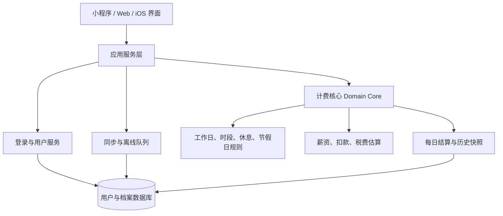

# 可配置按时薪酬应用：开发架构

## 1. 产品主流程

```text
注册/登录
  ↓
创建工作档案
  ↓
设置薪资口径
  ↓
设置工作日期和时间段
  ↓
设置午休、休息和节假日规则
  ↓
预览本月工作日、工作时长和每秒单价
  ↓
确认并开始今日计费
  ↓
每日结算，保存历史记录
```

用户可以创建多个档案，例如“公司全职”“客户 A”“周末兼职”。每个档案有独立的工作规则和历史记录。

## 2. 分层架构



### Domain Core

纯计算模块，不依赖页面、微信 API 或 iOS API。输入配置和时间，输出工作区间、计费时长、收入和扣款估算。

核心函数建议：

```ts
getScheduleForDate(date, workRule): TimeSegment[]
getBillableMilliseconds(range, workRule, calendarRule): number
calculateRate(payRule, monthPlan): RateResult
calculateDailyLedger(date, snapshot, timerEvents): DailyLedger
calculateDeductions(gross, deductionRule): DeductionResult
```

### Application Service

负责“开始、暂停、继续、结束、跨天、同步”等业务动作，但不直接计算金额。

```ts
createProfile()
updateProfile()
startTimer()
pauseTimer()
resumeTimer()
finishDay()
rollToNextDay()
syncPendingEvents()
```

### Platform Adapter

每个平台只负责平台差异：

- 微信：`wx.login`、`wx.setStorage`、订阅消息。
- iOS：Apple 登录、Keychain、UserNotifications。
- Web：浏览器存储、弹窗和网页通知。

这些平台 API 不允许出现在 Domain Core 中。

## 3. 用户注册与首次设置

### 注册方式

账号系统只保存用户身份，不保存明文密码：

- 微信小程序：微信登录。
- iOS：Sign in with Apple。
- Web：邮箱验证码或魔法链接。

三种登录方式最后都映射到同一个 `userId`。用户登录后进入首次设置向导。

### 首次设置向导

#### 第一步：工作身份

- 档案名称：例如“我的全职工作”。
- 所在地区和时区。
- 货币：CNY、USD、EUR 等。
- 是否需要社保、公积金和税费估算。

#### 第二步：收入方式

- 月薪、年薪、日薪或时薪。
- 税前收入或到手收入。
- 金额和货币。
- 月薪分摊方式：按本月实际工作日、固定工作日或固定月工时。
- 可选：津贴、提成、加班倍率。

第一版建议默认只启用“税前月薪”，其他选项放入高级设置。

#### 第三步：工作日期

提供预设按钮：

- 周一至周五。
- 周一至周六。
- 自定义每周工作日。
- 轮班周期。

用户也可以选择日期后逐日覆盖，例如某个周六加班、某个工作日调休。

#### 第四步：工作时间和午休

每一天由可编辑时间段组成：

```text
上午工作：09:00 → 12:00，计费
午休：12:00 → 13:30，不计费
下午工作：13:30 → 18:30，计费
```

时间段组件需要支持：

- 添加、删除、拖动排序。
- 开始时间和结束时间。
- 是否计费。
- 跨日选项，例如 22:00 → 次日 06:00。
- 检查重叠和结束时间早于开始时间。

#### 第五步：确认预览

确认页显示：

- 本月预计工作日。
- 本月预计计费小时。
- 每小时、每分钟、每秒收入。
- 今日预计收入。
- 当前规则摘要。

用户点击“确认并开始今天”后，档案才进入计时状态。

## 4. 数据模型

### User

```ts
type User = {
  id: string
  createdAt: string
  locale: string
  defaultProfileId?: string
}
```

### WorkProfile

```ts
type WorkProfile = {
  id: string
  userId: string
  name: string
  timezone: string          // IANA，例如 Asia/Shanghai
  currency: string
  schedule: ScheduleRule
  compensation: CompensationRule
  deductions?: DeductionRule
  calendar: CalendarRule
  version: number
  updatedAt: string
}
```

### ScheduleRule

```ts
type ScheduleRule = {
  weekly: {
    1?: TimeSegment[]
    2?: TimeSegment[]
    3?: TimeSegment[]
    4?: TimeSegment[]
    5?: TimeSegment[]
    6?: TimeSegment[]
    7?: TimeSegment[]
  }
  cycle?: { length: number; workingDays: number[] }
  overrides: Record<string, 'work' | 'off'>
}

type TimeSegment = {
  start: string       // HH:mm
  end: string         // HH:mm
  dayOffset?: number  // 跨日时为 1
  billable: boolean
  label?: string      // 工作、午休、茶歇、培训
}
```

午休不需要单独写死成一个字段。它就是 `billable: false` 的时间段，因此可以支持 30 分钟、90 分钟、分段午休和多次休息。

### CompensationRule

```ts
type CompensationRule = {
  mode: 'monthly' | 'annual' | 'daily' | 'hourly'
  amount: number
  salaryType: 'gross' | 'net'
  monthlyBasis: 'actual_workdays' | 'fixed_days' | 'fixed_hours'
  fixedDays?: number
  fixedHours?: number
  allowances: Array<{
    name: string
    amount: number
    mode: 'fixed' | 'percent'
    countInRate: boolean
  }>
  overtime: Array<{
    name: string
    multiplier: number
    enabled: boolean
  }>
}
```

### DeductionRule

```ts
type DeductionRule = {
  enabled: boolean
  region?: string
  year?: number
  items: Array<{
    key: 'pension' | 'medical' | 'unemployment' | 'maternity' | 'injury' | 'housing_fund'
    enabled: boolean
    base: 'gross' | 'custom'
    baseValue?: number
    minBase?: number
    maxBase?: number
    employeeRate?: number
    employerRate?: number
    employeeFixed?: number
    employerFixed?: number
  }>
  tax: {
    enabled: boolean
    mode: 'none' | 'monthly_estimate' | 'brackets'
    monthlyEstimate?: number
    specialDeduction?: number
  }
}
```

比例和基数不能硬编码。地区规则变化时，用户或管理员可以更新规则版本。

### TimerEvent

不要每秒写一条记录，只保存事件：

```ts
type TimerEvent = {
  id: string
  profileId: string
  type: 'start' | 'pause' | 'resume' | 'finish'
  occurredAt: string
  timezone: string
  clientId: string
}
```

### DailyLedger

```ts
type DailyLedger = {
  id: string
  profileId: string
  date: string
  timezone: string
  profileVersion: number
  scheduledMs: number
  billableMs: number
  grossEarned: number
  employeeDeductions: number
  taxEstimate: number
  netEstimate: number
  employerCost: number
  currency: string
  status: 'open' | 'settled'
  configSnapshot: object
}
```

历史记录必须保存 `configSnapshot`。用户今天把月薪从 11,200 改成 15,000，昨天的收入不能跟着变化。

## 5. 计时和跨天逻辑

计时器只显示实时结果，金额由时间戳推导：

```text
当前计费时长 = 所有 start/resume 到 pause/finish 的时间段
              与工作日、工作时间段的交集

今日收入 = 今日计费时长 × 今日规则对应的单价
```

页面进入前台、用户点击按钮、每秒刷新显示时，都调用同一个 `calculateDailyLedger`。即使应用在后台几个小时，回到前台仍能得到正确结果。

跨天时：

1. 用昨天的 `profileVersion` 结算昨天。
2. 将昨天的结果写入 `DailyLedger`。
3. 创建今天的开放记录。
4. 使用今天的规则重新计算。

## 6. UI 组件拆分

```text
AppShell
├─ AuthGate
├─ ProfileSwitcher
├─ OnboardingWizard
│  ├─ ProfileBasicsStep
│  ├─ CompensationStep
│  ├─ WorkdaysStep
│  ├─ ScheduleEditorStep
│  └─ PreviewStep
├─ TimerDashboard
│  ├─ TodayTimerCard
│  ├─ EarningsModeSwitcher
│  ├─ TodayBreakdown
│  └─ MonthlyProjection
├─ ProfileSettings
│  ├─ WorkdayEditor
│  ├─ TimeSegmentEditor
│  ├─ CalendarOverrideEditor
│  ├─ CompensationEditor
│  └─ DeductionEditor
└─ LedgerHistory
```

每个编辑组件只负责编辑和校验，不负责算钱。例如 `TimeSegmentEditor` 输出 `TimeSegment[]`，由 Domain Core 计算计费结果。

## 7. 推荐的第一版范围

### 必须完成

- 注册/登录。
- 一个用户多个工作档案。
- 自定义工作日。
- 自定义多个工作时段和午休。
- 税前月薪、时薪和货币。
- 每日自动结算。
- 本地离线缓存和登录后同步。

### 第二阶段

- 社保、公积金和个税估算。
- 节假日地区模板。
- 轮班和跨日班次。
- 加班倍率、津贴和提成。
- iOS 本地通知。

### 暂不放进第一版

- 工资发放和转账。
- 自动申报税费。
- 把某个城市的社保比例写死。
- 依赖后台持续运行的秒级计时。

## 8. 技术落地建议

第一步先把当前 HTML 中的 `WINDOWS` 常量、`8 小时/天` 和固定周一至周五逻辑移出页面，改成 `ScheduleRule` 驱动。然后做本地数据迁移：旧配置自动生成一个“我的工作档案”。

小程序、Web 和 iOS 后续共用 Domain Core 和 API 契约；页面只实现各平台自己的交互。这样新增“单休、轮班、小时工或海外时区”时，只增加配置和测试，不重写计时器。

